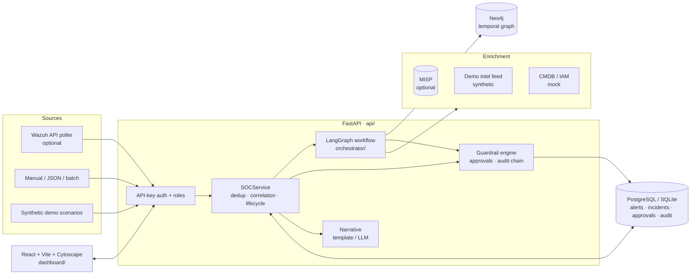
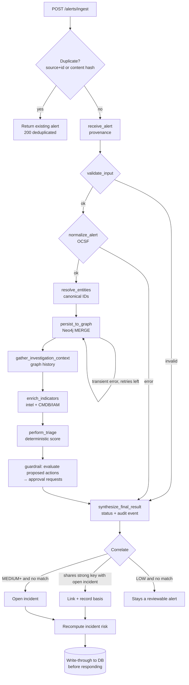
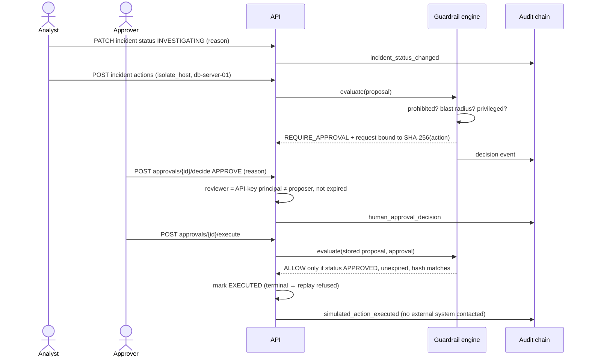

# ThreatFusion AI

> **An agentic SOC copilot with temporal knowledge-graph memory.** It ingests security alerts, normalizes them to OCSF, enriches and correlates them into incidents, scores them with explainable deterministic rules, and routes every response action through human approval and a tamper-evident audit log.

**Status: working lab / portfolio release, not production-ready.** The end-to-end workflow below was verified on macOS (Apple Silicon) in this repository. Every response action is **simulated**, and the demo data is **synthetic** and labelled as such. See [Project status](#project-status) for exactly what was verified.

---

## Table of contents

1. [Project status](#project-status)
2. [Problem and motivation](#problem-and-motivation)
3. [Goals and intended users](#goals-and-intended-users)
4. [Key features](#key-features)
5. [Architecture](#architecture)
6. [End-to-end data flow](#end-to-end-data-flow)
7. [Technology stack](#technology-stack)
8. [Repository structure](#repository-structure)
9. [Prerequisites](#prerequisites)
10. [Quick start (macOS)](#quick-start-macos)
11. [Linux and Windows](#linux-and-windows)
12. [Environment configuration](#environment-configuration)
13. [Running without Docker](#running-without-docker)
14. [Demo mode and synthetic scenarios](#demo-mode-and-synthetic-scenarios)
15. [Wazuh integration](#wazuh-integration)
16. [MISP integration](#misp-integration)
17. [LLM configuration and fallback](#llm-configuration-and-fallback)
18. [API reference](#api-reference)
19. [Authentication and security model](#authentication-and-security-model)
20. [Triage scoring methodology](#triage-scoring-methodology)
21. [Graph data model and correlation](#graph-data-model-and-correlation)
22. [Human approval workflow](#human-approval-workflow)
23. [Audit logging](#audit-logging)
24. [Testing and linting](#testing-and-linting)
25. [Troubleshooting](#troubleshooting)
26. [Known limitations](#known-limitations)
27. [Security considerations and responsible use](#security-considerations-and-responsible-use)
28. [Roadmap](#roadmap)
29. [Contributing](#contributing)
30. [License](#license)

---

## Project status

Legend: ✅ implemented **and verified** in this repo · 🟡 implemented, **not verified** against the real external system · ⏳ planned

| Capability | Status | Notes |
|---|---|---|
| FastAPI backend, LangGraph workflow (9 stages, bounded retry) | ✅ | Unit + API tests; live run |
| Alert ingestion: API, batch, dashboard JSON, demo scenarios | ✅ | Dedup by source+ID or content hash |
| OCSF normalization (incl. Windows eventdata, process, domains) | ✅ | Raw alert preserved verbatim |
| Deterministic triage with per-factor score breakdown | ✅ | Intel, CMDB criticality, privilege, ATT&CK, exposure, recurrence |
| Incident correlation with recorded basis and confidence | ✅ | Strong keys only, 24 h window |
| Threat-intel verdicts (MALICIOUS/SUSPICIOUS/BENIGN/UNKNOWN) | ✅ | Synthetic demo feed. Absence of intel = UNKNOWN |
| MISP enrichment | 🟡 | Client + verdict mapping unit-tested with mocks; no MISP instance available |
| Wazuh polling | 🟡 | Client/poller unit-tested with mocks; no Wazuh instance available |
| Neo4j temporal graph persistence and graph views | ✅ | Live Neo4j 5.24 container (see status doc) |
| Graph fallback when Neo4j is down | ✅ | Labelled “not persisted” |
| PostgreSQL persistence across restarts | ✅ | Live PostgreSQL 16 container |
| SQLite persistence (no Docker) | ✅ | Restart test |
| API-key auth + roles + separation of duties | ✅ | Role matrix test covers every route |
| Rate limiting, auth brute-force lockout, streaming body limit | ✅ | Per client IP, in-process (see Known limitations) |
| Human approval: hash binding, expiry, single use, tamper detection | ✅ | |
| Simulated response execution | ✅ | No external system is ever contacted |
| Hash-chained audit log + verification endpoint | ✅ | Tamper-evident, not immutable |
| Evidence-cited investigation narrative (template) | ✅ | |
| LLM narrative (Anthropic / Ollama) | 🟡 | Validation + fallback tested with mocks; no LLM credentials used |
| React dashboard (9 views, Cytoscape graph) | ✅ | Type-checked build; driven manually against the live API |
| Browser end-to-end test (analyst → approver → audit) | ✅ | Playwright in local Chrome against an isolated stack |
| Reproducible detection benchmark | ✅ | `python -m simulation.benchmark` → [`docs/DETECTION_EVALUATION.md`](docs/DETECTION_EVALUATION.md) |
| Redis | ⏳ | Provisioned in compose, **not used by the code** |
| Alembic migrations, OIDC/SSO, real response integrations | ⏳ | See roadmap |

Details and test counts: [`docs/IMPLEMENTATION_STATUS.md`](docs/IMPLEMENTATION_STATUS.md). Release audit: [`docs/RELEASE_READINESS.md`](docs/RELEASE_READINESS.md).

## Problem and motivation

SOC analysts face high alert volume, context scattered across tools, and pressure to act quickly on incomplete evidence. AI assistants can help with that, but only if they cannot be talked into unsafe actions by attacker-controlled log text, and only if their claims can be traced to evidence. ThreatFusion AI explores that design: **deterministic code makes every decision that matters** (scoring, priority, guardrails), a knowledge graph provides memory across incidents, and AI is limited to explaining evidence it is shown.

## Goals and intended users

- **Tier 1/2 SOC analysts**: triage faster, with every score explained factor by factor.
- **Incident responders**: see correlated alerts, entities, and the timeline in one workspace.
- **Approvers / SOC leads**: decide on response actions with full context and an auditable trail.
- **Security engineers and students**: a readable reference implementation of safe AI-assisted SOC tooling.

## Key features

- **Ingest → Validate → Normalize → Enrich → Correlate → Investigate → Triage → Recommend → Approve → Audit**
- OCSF-style normalization of Wazuh-format alerts, with provenance and the raw alert preserved.
- Explainable 0–100 risk score: every point is attributed to a named factor and evidence reference.
- Incidents built from strong-entity correlation, each link carrying its basis and confidence.
- Neo4j temporal graph: every edge has `valid_from`, `valid_to`, `confidence`, `source`.
- Threat-intel verdicts that never treat "no data" as "safe".
- Human-in-the-loop approvals bound to a SHA-256 action hash, with expiry, single use, and no self-approval.
- SHA-256 hash-chained audit log with live verification.
- Optional LLM narrative that must cite evidence IDs, and is rejected and replaced by a template otherwise.
- Dashboard: SOC overview, alerts, incidents and investigation workspace, knowledge graph, threat intel, approvals, audit log, integrations.

## Architecture



**Roles of each component, plainly:**

- **OCSF** (Open Cybersecurity Schema Framework) is a common vocabulary for security events. Mapping every source into it means downstream logic works with `device`, `user`, `src_endpoint` rather than vendor-specific field names. We implement a documented subset of the Security Finding class.
- **LangGraph** runs the per-alert pipeline as a graph of small, testable nodes with conditional edges. Invalid input jumps straight to the final node, and transient Neo4j failures loop back with a bounded retry count, so every run terminates with an honest COMPLETED / PARTIAL / FAILED status.
- **Neo4j** is the long-term memory: hosts, accounts, IPs, techniques, and findings as nodes, connected by time-stamped, confidence-weighted, source-attributed edges. It answers "has this asset been hit before?" and powers the graph views.
- **PostgreSQL** is the durable system of record for alerts, incidents, approvals, and the audit chain. SQLite provides the same for a no-Docker run.
- **Redis** is provisioned in `docker-compose.yml` but **not used** by the current code.
- **Wazuh** is an open-source SIEM/XDR whose rule alerts are the native input format. **MISP** is an open-source threat-intel platform used to look up indicators. Both are optional.

## End-to-end data flow



### Incident investigation and approval lifecycle



## Technology stack

| Layer | Technology |
|---|---|
| Backend | Python 3.12+ (verified on 3.13), FastAPI, uvicorn, Pydantic v2 |
| Orchestration | LangGraph |
| Normalization | OCSF Security Finding (project subset) |
| Graph | Neo4j 5.24 Community (official async driver) |
| Relational | PostgreSQL 16 (asyncpg) or SQLite (aiosqlite) via SQLAlchemy 2 async |
| Threat intel | MISP (optional) + synthetic demo feed |
| Frontend | React 18, TypeScript, Vite 6, Cytoscape.js, lucide-react |
| Tests / quality | pytest, pytest-asyncio, ruff, mypy, `tsc`, Playwright |
| Infrastructure | Docker Compose (PostgreSQL, Neo4j, Redis) |

## Repository structure

```text
ThreatFusion-AI/
├── agents/          Deterministic triage, investigation context, evidence-bound narrative
├── api/             FastAPI app, routes, auth, service layer, incidents, store, persistence
├── core/            Settings (pydantic-settings), structured logging, health model
├── graph/           Entity resolver (canonical IDs) and async Neo4j client
├── guardrails/      Policy engine, approvals, hash-chained audit, action catalog
├── ingestion/       Wazuh client/poller, MISP client, CMDB/IAM mock, intel verdicts, enrichment
├── normalization/   OCSF models + normalizer, ATT&CK reference labels, IP helpers
├── orchestrator/    LangGraph state, nodes, edges, workflow runner
├── simulation/      Labeled benchmark scenarios + synthetic demo storylines
├── dashboard/       React + Vite + Cytoscape SOC console
├── scripts/         bootstrap_env.py (generates .env with random secrets and API keys)
├── tests/           unit/ (no services needed) and integration/ (live Neo4j)
├── docs/            Architecture, API, security, demo guide, troubleshooting, ADRs, status
└── docker-compose.yml
```

## Prerequisites

| Tool | Version |
|---|---|
| Python | ≥ 3.12 |
| Node.js | ≥ 20 (verified with 22) |
| Docker Desktop / Engine | Recent version with Compose v2 (verified with Docker 29) |

## Quick start (macOS)

```bash
# 1. Python environment
python3 -m venv .venv
source .venv/bin/activate
pip install -e ".[dev]"

# 2. Configuration: copies .env.example → .env with random secrets and 3 API keys
python scripts/bootstrap_env.py          # prints viewer / analyst / approver keys

# 3. Infrastructure (PostgreSQL, Neo4j, Redis on 127.0.0.1)
docker compose up -d
docker compose ps                         # wait until all are "healthy" (Neo4j ~30–60 s)

# 4. Backend (single worker — see Known limitations)
uvicorn api.app:app --host 127.0.0.1 --port 8000

# 5. Frontend (new terminal)
cd dashboard
npm install
npm run dev                               # http://localhost:5173
```

Sign in with the **analyst** key, open **Alerts**, and load the *Multi-stage intrusion* scenario. Then follow [`docs/DEMO_GUIDE.md`](docs/DEMO_GUIDE.md).

If ports 5432 or 6379 are already in use on your machine, see [Troubleshooting](docs/TROUBLESHOOTING.md#docker--infrastructure).

## Linux and Windows

**Linux**: same commands as macOS. Only macOS was verified in this release.

**Windows (PowerShell)**: not verified in this release. Equivalent commands:

```powershell
python -m venv .venv
.venv\Scripts\Activate.ps1
pip install -e ".[dev]"
python scripts\bootstrap_env.py
docker compose up -d
uvicorn api.app:app --host 127.0.0.1 --port 8000
```

## Environment configuration

All configuration comes from environment variables or `.env` (git-ignored). [`.env.example`](.env.example) lists every variable with placeholders only. Key settings:

| Variable | Default | Purpose |
|---|---|---|
| `API_KEYS` | placeholders | `name:role:key,…`; roles `viewer`, `analyst`, `approver`, `admin` |
| `PERSISTENCE_BACKEND` | `postgres` | `postgres`, `sqlite`, or `memory` (data lost on restart) |
| `SQLITE_PATH` | `./threatfusion.db` | SQLite file when using `sqlite` |
| `NEO4J_ENABLED` | `true` | Connect to Neo4j at startup (falls back if unreachable) |
| `DEMO_MODE` | `true` | Enables demo scenarios and the synthetic intel feed |
| `WAZUH_ENABLED` | `false` | Start the background Wazuh poller |
| `MISP_URL` / `MISP_API_KEY` | placeholder | MISP lookups are enabled only with a non-placeholder key |
| `LLM_PROVIDER` | `none` | `none`, `anthropic`, `ollama` |
| `APPROVAL_TIMEOUT_SECONDS` | `1800` | Approval expiry |
| `MAX_ISOLATION_BLAST_RADIUS` | `3` | Maximum targets per action |
| `CORS_ORIGINS` | localhost:5173 | Explicit allow-list |
| `APP_ENV` | `development` | `production` rejects placeholder secrets and disabled TLS verification |

Database schema: the four tables (`tf_alerts`, `tf_incidents`, `tf_approvals`, `tf_audit_events`) are created idempotently when the API starts. No manual migration step is needed in this release.

## Running without Docker

```bash
# in .env
PERSISTENCE_BACKEND=sqlite
NEO4J_ENABLED=false
```

The API, dashboard, demo scenarios, triage, approvals, and audit all work. Graph views are built from per-alert entity resolution and labelled **not persisted**.

## Demo mode and synthetic scenarios

With `DEMO_MODE=true`, four scenarios can be loaded from the dashboard or `POST /api/v1/demo/scenarios/{id}/load`:

| Scenario | What it shows |
|---|---|
| `intrusion-chain` | 6 alerts: SSH brute force → login → encoded PowerShell → sudo escalation → lateral SSH → 2 GB upload. Correlates into **one CRITICAL incident** spanning 2 hosts and 6 ATT&CK tactics |
| `c2-beacon` | Beaconing to an indicator marked MALICIOUS in the synthetic feed. The threat-intel factor is visible in the score |
| `benign-activity` | A package update to an allow-listed mirror (stays LOW, no incident) and an off-hours login (MEDIUM incident, candidate for false positive) |
| `adversarial-telemetry` | Alert text addressed to an AI ("ignore all safety rules"). It is scored by rules and shown as data, never followed |

All scenario data uses RFC 5737 documentation IPs and `example.*` domains, carries `synthetic: true`, and is badged in the UI. Loading is idempotent.

## Wazuh integration

🟡 Implemented, not verified against a live Wazuh manager here.

1. Create a read-only Wazuh API user.
2. Set `WAZUH_ENABLED=true`, `WAZUH_API_URL=https://<manager>:55000` (HTTPS is required), `WAZUH_API_USER`, `WAZUH_API_PASSWORD`, and `WAZUH_VERIFY_SSL` (`false` only for self-signed certificates in a lab; `production` rejects it).
3. Set `WAZUH_ALERTS_ENDPOINT` to the endpoint that returns alerts in your deployment. On many Wazuh versions, alerts live in the **Wazuh indexer**, not the server API.
4. Restart the API. `/api/v1/integrations/status` shows `wazuh.status: polling`.

The poller retries with exponential backoff, deduplicates IDs, uses a timestamp watermark, prevents overlapping polls, and stops on authentication or TLS errors. Polled alerts go through the same pipeline as API submissions.

Without Wazuh, you can forward alerts from any tool that emits Wazuh-format JSON with `POST /api/v1/alerts/ingest` (or `/batch`).

## MISP integration

🟡 Implemented, not verified against a live MISP instance here.

Set `MISP_URL`, `MISP_API_KEY` (an auth key with read access), and `MISP_VERIFY_SSL`. Each observed IP and domain is queried via `/attributes/restSearch`. Verdicts: a match with threat level *High* is MALICIOUS; other matches are SUSPICIOUS; no match, a timeout, or an error is UNKNOWN, with the reason recorded. A lookup failure never blocks triage and never lowers a score.

The repository contains a `misp-docker` gitlink without a `.gitmodules` entry, so `git submodule update` cannot fetch it. Use the upstream [MISP docker project](https://github.com/MISP/misp-docker) to run a local MISP.

## LLM configuration and fallback

The LLM is used **only** for the incident narrative. It cannot change scores, priority, status, or guardrail decisions.

| `LLM_PROVIDER` | Behaviour |
|---|---|
| `none` (default) | Deterministic template narrative |
| `anthropic` | `pip install -e ".[llm]"`, set `LLM_API_KEY`; model from `REASONING_LLM_MODEL` (default `claude-opus-5-5`) |
| `ollama` | Local model at `LLM_BASE_URL` (default `http://localhost:11434`), model from `REASONING_LLM_MODEL` |
| `openai`, `gemini` | Accepted for configuration compatibility, **not implemented**; the template is used and the UI says so |

The model receives numbered evidence (E1, E2, …) inside an `<evidence>` block declared untrusted. It must return JSON in which every fact and hypothesis cites evidence IDs. Invalid JSON, unknown or missing citations, a refusal, or a call failure discards the output, and the template is shown with the reason.

## API reference

Full reference with examples: [`docs/API_REFERENCE.md`](docs/API_REFERENCE.md). Live OpenAPI: `http://127.0.0.1:8000/docs`.

Example: ingest an alert and read back the triage.

```bash
KEY=$(grep ^API_KEYS .env | tr ',' '\n' | grep ':analyst:' | cut -d: -f3)
curl -s -X POST http://127.0.0.1:8000/api/v1/alerts/ingest \
  -H "Authorization: Bearer $KEY" -H 'Content-Type: application/json' \
  -d '{"source":"manual","raw_alert":{"id":"readme-1","timestamp":"2026-10-27T10:00:00Z",
       "rule":{"level":12,"description":"Encoded PowerShell","mitre":{"id":["T1059.001"]}},
       "agent":{"id":"002","name":"db-server-01","ip":"192.168.1.51"},
       "data":{"win":{"eventdata":{"targetUserName":"admin","commandLine":"powershell -enc AAAA"}}}}}' \
  | python3 -c 'import sys,json; d=json.load(sys.stdin); t=d["triage_result"]; print(d["alert_id"], t["priority"], t["score"], "incident", d["incident_id"]); [print("  %4d %s: %s" % (c["points"], c["factor"], c["detail"])) for c in t["score_breakdown"]]; print("  rule:", t["priority_rule"])'
```

Example output, captured from the running API:

```text
alert-8ba4a5da4fb30224 CRITICAL 100 incident INC-86076C9E
    60 base_severity: OCSF severity High (level 4)
    15 privileged_account: Account 'admin' is privileged (IAM record)
    15 high_impact_technique: Alert maps to high-impact ATT&CK technique T1059.001 (Execution)
    10 asset_criticality: CMDB criticality CRITICAL for db-server-01
  rule: Score 100: >=80 CRITICAL, >=60 HIGH, >=35 MEDIUM, else LOW
```

(Here the alert correlated into an incident already open for `db-server-01` via the same Wazuh agent ID. Sending the same alert again returns HTTP 200 with `"deduplicated": true`.)

## Authentication and security model

- Every endpoint except `/health*` requires `Authorization: Bearer <key>`.
- Roles: `viewer` (read) < `analyst` (ingest, notes, status, propose actions, narrative) < `approver` (decide, execute).
- The audit actor is always the authenticated principal. Body fields such as `reviewer_id` are ignored.
- No valid keys configured → 401 everywhere (fail closed).

This is suitable for a **trusted local or lab deployment only**. See [`docs/SECURITY.md`](docs/SECURITY.md) for the threat model.

## Triage scoring methodology

Implemented in [`agents/triage.py`](agents/triage.py). Each factor applies **at most once** per alert, and each is recorded in `score_breakdown` with its points and evidence reference. The breakdown always sums to the score.

| Factor | Points | Evidence |
|---|---|---|
| Base severity (from Wazuh level → OCSF) | Critical 80 · High 60 · Medium 40 · Low 20 · Info 10 · Unknown 25 | Rule level |
| Privileged account (name list **or** IAM flag, counted once) | +15 | Account |
| External IP in source or destination (once) | +10 | Endpoint IP |
| High-impact ATT&CK technique/tactic from the rule (once) | +15 | Technique ID |
| Recurrence on the asset in Neo4j: ≥3 / ≥5 prior findings | +15 / +20 | Graph history |
| Threat intel: strongest verdict MALICIOUS / SUSPICIOUS (once) | +20 / +10 | Indicator verdict |
| CMDB asset criticality CRITICAL / HIGH | +10 / +5 | CMDB record |
| UNKNOWN intel, missing CMDB record, missing device/timestamp | 0, listed as uncertainty | — |

Score is clamped to 0–100. Priority: **≥80 CRITICAL, ≥60 HIGH, ≥35 MEDIUM, else LOW**, with three rules on top:

- A critical-severity alert with a privileged account or a high-impact technique is always CRITICAL.
- An informational alert with no risk factors is always LOW.
- **Context alone cannot make an alert CRITICAL.** Asset criticality and SUSPICIOUS intel describe the environment, not the detected behaviour, so they can raise an alert at most to HIGH. CRITICAL requires an intrinsic score ≥80 (without context points), a hard rule, or a MALICIOUS intel verdict.

The rule applied is returned as `priority_rule`.

**Benchmark.** `python -m simulation.benchmark` runs the repository's 20-alert synthetic labelled set through the real workflow with enrichment off and on. The output is in [`docs/DETECTION_EVALUATION.md`](docs/DETECTION_EVALUATION.md): confusion matrices, per-class precision/recall/F1/FPR/FNR, and every miss with its score contributions. Current results: **85% accuracy (macro-F1 0.859) without enrichment, 80% (0.815) with it**, with zero under-escalations and 100% recall on HIGH+CRITICAL in both modes. All 3 baseline misses, and 3 of the 4 enriched misses, are the same rule/label disagreement: alerts the project labelled HIGH whose *intrinsic* detection factors already reach CRITICAL. The fourth enriched miss is context-driven: asset criticality takes a MEDIUM to HIGH. The labels are author-written and tiny, so this is a regression check, not an accuracy claim, and weights were deliberately **not** tuned to it.

**Incident risk** = highest alert score + attack-progression bonus (+5 for 2 distinct tactics, +10 for 3 or more). Incident priority never drops below its highest alert's priority. Alert-level factors are not re-added, so there's no double counting.

**Same-indicator evidence counts once.** When threat intel scores an IP that also earned *external exposure*, the intel factor subsumes the exposure points ("subsumes +10 external exposure of the same IP"), because a reputation hit on an IP already implies it is external. The subsumed points still count as intrinsic evidence for the CRITICAL rule. Only external IPs and domains are sent to intel sources; private addresses are never looked up.

## Graph data model and correlation

**Nodes**: `Incident` (one per finding), `Asset`, `Identity`, `IOC`, `TTP`. **Relationships**: `AFFECTS` (finding → asset), `INVOLVES` (finding → identity), `CONTACTED` (finding/IP → IP), `USES` (finding → technique). Every relationship carries `valid_from`, `valid_to`, `confidence`, `source`, plus `last_seen`, and is written with parameterized `MERGE` (idempotent). Uniqueness constraints exist on `id` for every label.

**Canonical IDs** are deterministic: `asset:agent:001`, `asset:host:<name>`, `identity:user:<user>@<host>` (generic accounts like `root` are always host-scoped), `ioc:ip:<ip>`, `ttp:mitre:<technique>`, `finding:<uid>`.

**Incident correlation** ([`api/incidents.py`](api/incidents.py)) links an alert to an open incident only through a shared strong key within 24 hours of the incident's activity. Each link is stored with its basis and confidence:

| Key | Confidence |
|---|---|
| Same Wazuh agent ID | 0.9 |
| Same account on the same host | 0.8 |
| Same non-generic hostname (no agent ID) | 0.7 |
| Same external IP | 0.6 |
| Same internal host address (e.g. traffic *from* a host's IP) | 0.5 |

Generic hostnames, unscoped generic usernames, and private IPs as standalone indicators never correlate.

## Human approval workflow

1. Triage or an analyst proposes an action from the catalog. Targets must be hosts, IPs, or accounts already observed in the incident.
2. The guardrail denies prohibited actions and over-broad blast radius, flags privileged targets, and requires approval for every containment, remediation, or administrative action.
3. The approval request stores the full proposal and its SHA-256 hash, and expires after `APPROVAL_TIMEOUT_SECONDS`.
4. An approver who did not propose it approves or rejects it. Decisions are final.
5. Execution re-runs the guardrail against the stored proposal. If anything changed, the hash no longer matches and execution is denied. On success the request becomes `EXECUTED`, and later attempts get 409.
6. Every step is written to the audit chain. **Execution is simulated.**

## Audit logging

Each event stores `prev_event_hash` and `event_hash = SHA-256(canonical event + prev hash)`. Before hashing, secrets are redacted and control characters stripped. Events are persisted in order and reloaded and verified at startup. `GET /api/v1/audit/verify` recomputes the chain on demand, and `/health` returns 503 if it fails.

> A hash chain is **tamper-evident, not immutable**. It reveals edits, deletions, insertions, and reordering relative to the stored chain. An attacker who can rewrite the entire table can forge a new valid chain. Anchor the head hash externally for stronger guarantees.

## Testing and linting

```bash
pytest                          # unit + API + security tests (no services needed); live tests excluded
pytest -m integration           # live Neo4j test (requires docker compose + .env)
ruff check .
mypy .
python -m simulation.benchmark  # triage benchmark, enrichment off vs on (Markdown to stdout)
cd dashboard && npm run build   # tsc type-check + production build
cd dashboard && npm run test:e2e  # Playwright browser test (uses installed Google Chrome)
```

The browser test starts its own isolated API (port 8010, temporary SQLite file, Neo4j off, e2e-only keys) and Vite server (port 5175). It never touches your databases or a running demo. It needs the Python venv at `.venv` (override with `TF_PYTHON`) and Google Chrome installed.

Results from this release are recorded in [`docs/RELEASE_READINESS.md`](docs/RELEASE_READINESS.md).

## Troubleshooting

See [`docs/TROUBLESHOOTING.md`](docs/TROUBLESHOOTING.md). The most common issues:

- **Port 5432/6379 already in use**: remap with `POSTGRES_HOST_PORT`/`POSTGRES_PORT` and `REDIS_HOST_PORT`/`REDIS_PORT`.
- **API won't start, asyncpg connection error**: PostgreSQL isn't reachable. Persistence fails closed. Use `PERSISTENCE_BACKEND=sqlite` to run without Docker.
- **401 everywhere**: `API_KEYS` still contains placeholders. Run `scripts/bootstrap_env.py`.
- **Graph shows "not persisted"**: Neo4j wasn't reachable when the API started. Restart the API after Neo4j is healthy.

## Known limitations

- Not production-ready: API-key auth only (no SSO/MFA/rotation) and single-process state (run **one** uvicorn worker).
- Rate limiting and brute-force lockout are per client IP and in-process. Behind a proxy (including the Vite dev proxy) all users share one IP, so one client's failed logins lock everyone out for `AUTH_LOCKOUT_SECONDS`.
- Response actions are simulated. There are no EDR, firewall, or IdP integrations.
- Wazuh, MISP, and LLM providers were not verified against real services in this release.
- The CMDB/IAM provider is a mock with synthetic records.
- Redis is unused. No queueing or durable stream processing is claimed. Its only justified future use is a Redis Streams buffer if the API ever runs more than one worker.
- The schema is created at startup without Alembic migrations, and records are stored as JSON documents.
- The OCSF model is a documented subset of the Security Finding class, not full OCSF compliance.
- The working set (up to 5,000 alerts) is held in memory and reloaded fully at startup.
- Request-size limiting relies on `Content-Length`.

## Security considerations and responsible use

- Secrets live only in `.env` (git-ignored, mode 600). `.env.example` contains placeholders only.
- Databases are bound to `127.0.0.1` in `docker-compose.yml`. Do not expose them.
- All alert, intel, and CMDB content is treated as untrusted data and is never executed.
- The synthetic scenarios describe detections, not attack procedures.
- Use the platform only for systems you are authorized to monitor. Keep the human-approval gate in place if you add real response integrations.

Full details: [`docs/SECURITY.md`](docs/SECURITY.md).

## Roadmap

- Alembic migrations and a normalized relational schema for alerts and incidents
- OIDC/SSO, key rotation, and proxy-level rate limiting
- Verified Wazuh indexer and MISP integrations, with recorded fixtures
- Real, opt-in response connectors with confirmation and rollback
- External anchoring of the audit-chain head (e.g. signed timestamps)
- Redis Streams for durable ingestion and multi-worker deployments
- More Playwright coverage (graph interactions, false-positive closure, error states)

## Contributing

1. Read [`Claude.md`](Claude.md) (project constraints) and the ADRs in [`docs/adr/`](docs/adr/).
2. Keep decisions deterministic. LLMs may only explain evidence.
3. Add tests with every change. `pytest`, `ruff check .`, `mypy .`, `npm run build`, and `npm run test:e2e` must pass. New API routes must be added to the role matrix in `tests/unit/test_security_hardening.py`.
4. Never commit secrets. Use `.env`.
5. Write a one-paragraph ADR for any non-obvious technical choice.

## License

No license file is present in this repository, so all rights are reserved by the authors by default. Contact the repository owner before reusing the code.
